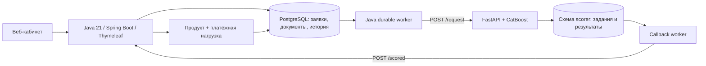

# Умный кредитный кабинет предпринимателя — MVP

Работающий кредитный путь малого бизнеса: выбор компании и продукта → черновик и финансовый отчёт →
рассмотрение → предложение условий, запрос дополнений или отказ → принятие и имитация подписания/выдачи.

**Решение связано с реальным Python-сервисом и сохранённой моделью CatBoost.** Фиктивных скоринговых
ответов, Java fallback-модели и принудительного `OK` нет. Данные синтетические; прогноз ставки и
упрощённая кредитная политика не являются реальным банковским решением.

## Запуск

Требуются Docker и Docker Compose. Для первой сборки нужен интернет к Docker Hub, Maven Central,
PyPI и пакетному репозиторию базового образа; работа основного сценария не требует платных API или
внешних банковских систем. Рекомендуемый запас для сборки: 4 ГБ RAM Docker и 6 ГБ свободного диска.

Из корня репозитория:

```sh
docker compose --profile app up --build -d --wait
```

Запускаются PostgreSQL, Python API с двумя фоновыми воркерами и Java-приложение. Версии образов
зафиксированы digest, Java-зависимости — Spring Boot BOM, Python — универсальным hash-lock-файлом.
Обучение при старте не выполняется. Открыть [вход](http://localhost:8080/login), затем
[новую заявку](http://localhost:8080/app), [мои заявки](http://localhost:8080/app/applications) или
[компании](http://localhost:8080/app/companies).

Compose — конфигурация локальной проверки: профиль `dev`, опубликованные тестовые ключи и
синтетические аккаунты. Публичный production-стенд требует собственных ключей/секретов и HTTPS.
Порты проброшены только на localhost. При занятом порте задайте, например:

```sh
POSTGRES_PORT=15432 APP_PORT=18080 SCORER_PORT=18000 \
docker compose --project-name credit-review --profile app up --build -d --wait
```

В Windows задайте переменные через `set`/PowerShell либо скопируйте `.env.example` в `.env` и
измените порты. Для обычного запуска менять конфигурацию не требуется.

Остановка с сохранением данных:

```sh
docker compose --profile app stop
```

**Не используйте `down -v`, если данные нужны.** Применённые миграции V1–V5 не изменены. При ошибке
Flyway checksum не ремонтируйте/не очищайте рабочую БД ради демонстрации: используйте отдельный
Compose-проект с новым volume. Нормальный перезапуск сохраняет состояние и документы.

## Синтетические аккаунты

Начальный пароль: **`DemoCredit2026!`**.

| Аккаунт | Роль | Компания |
| --- | --- | --- |
| `owner@demo.test` | OWNER | ООО «Демо Оборот» |
| `admin@demo.test` | ADMIN | ООО «Демо Оборот» |
| `viewer@demo.test` | VIEWER, только чтение | ООО «Демо Оборот» |
| `other@demo.test` | OWNER | ИП Демо Развитие |

На свежей базе профили содержат действующий статус, дату регистрации, категорию МСП и численность.
Seed добавляет отсутствующие записи и не переписывает существующие пароли, роли и профили. Поэтому
для воспроизводимой проверки нужны свежие seed-данные либо соответствующие им сохранённые профили.
В `prod` seed выключен; в `dev` отключается через `DEMO_DATA_ENABLED=false`.

## Проверка за несколько минут

1. Войти владельцем и выбрать «Оборотные средства».
2. Указать 1 000 000 ₽, 24 месяца, ежемесячно, без обеспечения. Финансы за месяц: выручка 1 000 000 ₽,
   расходы 600 000 ₽, текущие платежи 10 000 ₽. Сохранить черновик.
3. В карточке скачать JSON-шаблон, проверить ИНН/цифры и загрузить файл. Можно использовать
   [approved.json](demo/reports/approved.json). Отправка без сведений/отчёта даёт конкретный запрос дополнений.
4. Отправить на рассмотрение. Дождаться реальной обработки Python и предложения условий в этой же карточке.
5. Принять предложение, пройти явно помеченные имитации подписания и выдачи. Деньги не перечисляются.
6. Для меньшей суммы использовать финансы 100 000 / 60 000 / 0 ₽ и [reduced.json](demo/reports/reduced.json).
   Для отказа модели — 5 000 000 ₽ на 6 месяцев без обеспечения. Для отказа по нагрузке —
   [unaffordable.json](demo/reports/unaffordable.json) при параметрах кредита из шага 2.
7. Повторно войти: результаты и история сохраняются. `viewer` может читать, но не менять; `other`
   не видит чужие заявки/документы. После технического FAILED доступно «Повторить рассмотрение» с прежним UUID.

Полная автоматическая проверка реальных сервисов (Python 3 стандартной библиотеки, без сторонних пакетов):

```sh
python3 scripts/verify_mvp.py
```

Скрипт проходит положительный путь, оба вида отказа, изменение условий, дополнение сведений,
отмену, повторы, изоляцию компаний и CSRF. Он не генерирует callback и не подменяет модель.
[Все сценарии и проверка перезапуска](docs/test-scenarios.md).

## Архитектура



Python прогнозирует ставку и интерпретирует её по явно описанным синтетическим диапазонам.
Java независимо ограничивает сумму/условия по продукту и платёжной нагрузке. Одинаковый ML-вход
может дать разные итоговые решения при разных доходах/обязательствах. Запросы, модельный результат,
решение, версии и история сохраняются. Прогноз не является вероятностью дефолта.

Вычисление/HTTP выполняются вне DB-блокировок. Очереди восстанавливают lease после перезапуска,
дедуплицируют повторы, ограничивают попытки и не превращают технический сбой в кредитный отказ.

## Конфигурация

Основные переменные и примеры — [.env.example](.env.example).

| Переменная | Compose по умолчанию |
| --- | --- |
| `APP_PORT` / `POSTGRES_PORT` / `SCORER_PORT` | `8080` / `5432` / `8000` на localhost |
| `SCORER_ENABLED` | `true`; выключение намеренно приостанавливает отправку, не создаёт результат |
| `SCORER_BASE_URL` | `http://scorer:8000` из Java |
| `JAVA_BASE_URL` | `http://app:8080` из Python |
| `SCORER_TOKEN` | Общий опубликованный токен локальной проверки; для другого окружения заменить |
| `SCORER_DATABASE_URL` | Внутренний asyncpg URL PostgreSQL, задан в Compose |
| `SCORER_DB_SCHEMA` | `scorer` |

Сервисные URL внутри Docker не равны проброшенным портам хоста. Клиентский JWT/CSRF независимы
от `X-Scorer-Token`, который никогда не передаётся браузеру. `/api/health` проверяет Java/БД,
`http://localhost:8000/health` — модель, Python-воркеры и БД.

Для разработки Java на хосте: JDK 21+, Docker и `sh ./start_dev.sh` / `start_dev.bat`.
Скрипты поднимают PostgreSQL на 5433 и настоящий Python в Docker, собирают/тестируют Java и запускают
её на 8080. `start_dev_clean` **удаляет данные** только проекта `smartcreditor-dev`.

## Документация и проверки

- [Фактическая архитектура, состояния и модель данных](docs/architecture/mvp.md).
- [Описание API и надёжности обмена](docs/SCORER.md); [Java workflow](docs/MVP_JAVA.md).
- [OpenAPI кабинета](code/app/backend/src/main/resources/openapi/credit.yaml), также `GET /api/credit/openapi` после входа.
- [OpenAPI скорера/callback](docs/openapi/scorer.yaml); работающий Python Swagger: `http://localhost:8000/docs`.
- [Postman-коллекция](docs/requests/credit-mvp.postman_collection.json).
- [Исследование и границы MVP](docs/research.md); [сценарии/команды тестов](docs/test-scenarios.md).
- [Версия и комплект сдачи](docs/SUBMISSION.md), [сторонние компоненты и упрощения](THIRD_PARTY_NOTICES).
- [Manifest модели](code/scorer/artifacts/selected_model.validation.json) и [эксперимент/ограничения](code/scorer/docs/EXPERIMENT.md).

Java-тесты используют случайные схемы PostgreSQL. Python-тесты включают реальную модель и, при
заданном `SCORER_TEST_DATABASE_URL`, настоящую БД. Подмены HTTP/модели существуют только внутри
изолированных тестов ошибок; в продукте их нет. Исходная расширенная архитектура сохранена как план,
а отклонения реализации объяснены в ADR-0003/0004.

Реальные БКИ/ФНС/реестры не вызываются: сведения компании заявленные. Документы — JSON заданного
формата до 1 МиБ, без OCR. Интервью с реальными МСП и независимая валидация кредитного риска не заявляются.
