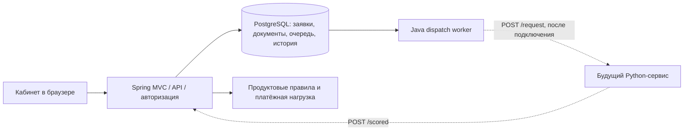

# Business Credit Portal — Java MVP

Кредитный кабинет малого бизнеса: компании и права доступа, продукты, черновики,
финансовые отчёты, отправка заявки, статусы, история и жизненный цикл предложения.
Spring Boot 4.1.1 / Java 21 / Thymeleaf / PostgreSQL / Flyway.

**Python-сервис будет подключён отдельно. Локального скоринга, демо-ответов и
резервной модели нет.** При выключенном обработчике полная заявка ожидает
рассмотрения в `SUBMITTED`; решения не генерируются.

## Запуск одной командой

Требуются Docker и Docker Compose. Из корня репозитория:

```sh
docker compose --profile app up --build -d --wait
```

Открыть [вход](http://localhost:8080/login), затем [новую заявку](http://localhost:8080/app),
[мои заявки](http://localhost:8080/app/applications) или [компании](http://localhost:8080/app/companies).
Первой сборке нужен доступ к Docker Hub и Maven Central. Для локального окружения
используются профиль `dev`, опубликованные тестовые ключи и синтетические аккаунты.
Для публичного размещения нужны собственные ключи, профиль `prod`, HTTPS и secure cookies.

Порты и будущий скорер настраиваются через `.env` по [.env.example](.env.example).
Данные хранятся в постоянном volume PostgreSQL. Остановка с сохранением данных:

```sh
docker compose --profile app stop
```

Не используйте `down -v`, если данные нужны. При несовпадении Flyway checksum
не изменяйте применённые миграции и не очищайте рабочую БД: создайте отдельный
Compose-проект для проверки с чистой базой.

Для разработки на хосте нужны JDK 21+ и Docker: `sh ./start_dev.sh` (macOS/Linux)
или `start_dev.bat` (Windows). Скрипты собирают и тестируют Java, затем запускают её
на 8080, PostgreSQL — на 5433. `start_dev_clean` **удаляет данные** проекта
`smartcreditor-dev`; обычный запуск их сохраняет.

## Тестовые аккаунты

Общий начальный пароль: **`DemoCredit2026!`**. Все данные синтетические.

| Аккаунт | Роль | Компания |
| --- | --- | --- |
| `owner@demo.test` | OWNER | ООО «Демо Оборот» |
| `admin@demo.test` | ADMIN | ООО «Демо Оборот» |
| `viewer@demo.test` | VIEWER, только чтение | ООО «Демо Оборот» |
| `other@demo.test` | OWNER | ИП Демо Развитие |

Seed добавляет отсутствующие записи в `dev`, не меняя существующие пароли и роли.
При активном `prod` seed выключен. `DEMO_DATA_ENABLED=false` отключает его в `dev`.

## Проверка основного пути

1. Войти как владелец. В «Компаниях» заполнить отсутствующие дату регистрации и
   заявленный статус, например `2020-01-01` / «Действует».
2. Создать заявку: «Оборотные средства», 1 000 000 ₽, 24 месяца, ежемесячно.
   Выручка — 1 000 000, расходы — 600 000, текущие платежи — 10 000 ₽/месяц.
3. Сохранить черновик. В карточке скачать JSON-шаблон отчёта, проверить значения
   и загрузить файл. Без сведений/отчёта отправка даст адресный запрос дополнений.
4. Отправить на рассмотрение. При выключенном скорере результат — `SUBMITTED`,
   без имитации решения. Перезагрузка и повторный вход сохраняют контекст.
5. Проверить просмотр через `viewer` и отсутствие доступа через `other`.
6. После подключения Python результат появится в этой же карточке. Для предложения
   доступны принятие/отказ и явно обозначенные имитации подписания и выдачи.

## Архитектура и граница Python



Для подключения задать `SCORER_ENABLED=true`, `SCORER_BASE_URL` и одинаковый
`SCORER_TOKEN` на обеих сторонах, затем пересоздать Java-контейнер. Контракт остаётся
`POST /request` → `202` → `POST /scored` → `204`. Ошибки связи, некорректный ответ и
кредитный отказ — разные исходы. Подробнее: [интеграция](docs/SCORER.md).

## Документация и тесты

- [Реализованный Java MVP, состояния, модель данных, ограничения и сценарии](docs/MVP_JAVA.md).
- [OpenAPI кабинета](code/app/backend/src/main/resources/openapi/credit.yaml), также `GET /api/credit/openapi` после входа.
- [OpenAPI обмена со скорером](docs/openapi/scorer.yaml).
- [Postman-коллекция](docs/requests/credit-mvp.postman_collection.json).
- [Авторизация](docs/AUTHORIZATION.md), [решение о границе Java/Python](docs/adr/0003-java-mvp-python-boundary.md).
- [Сторонние компоненты и упрощения](THIRD_PARTY_NOTICES).
- [Исходная целевая архитектура](docs/architecture/architecture.md) описывает более широкий план; текущая реализация и отклонения зафиксированы в ADR-0003.

```sh
POSTGRES_PORT=5433 docker compose --project-name smartcreditor-dev up -d --wait
cd code/app/backend
DB_URL=jdbc:postgresql://localhost:5433/smartcreditor sh ./mvnw test
```

Дополнительные проверки браузерного HTTP-клиента: `node --test src/test/js/credit-api.test.cjs`
из каталога backend (Node.js 18+, только для тестов).

Интеграционные тесты создают отдельные временные схемы и не очищают пользовательские
данные. HTTP-клиент скорера подменяется только в тестах; исполняемого режима
симуляции в приложении нет. В Windows задайте `DB_URL` перед `mvnw.cmd test`.

Реальные внешние проверки, OCR, подпись и перечисление средств не выполняются.
Профиль компании содержит заявленные сведения. Документы — структурированные JSON
до 1 МиБ, хранятся в БД. Существующий Python-код и модель в `code/scorer` не изменены
и не входят в контейнер Java.
