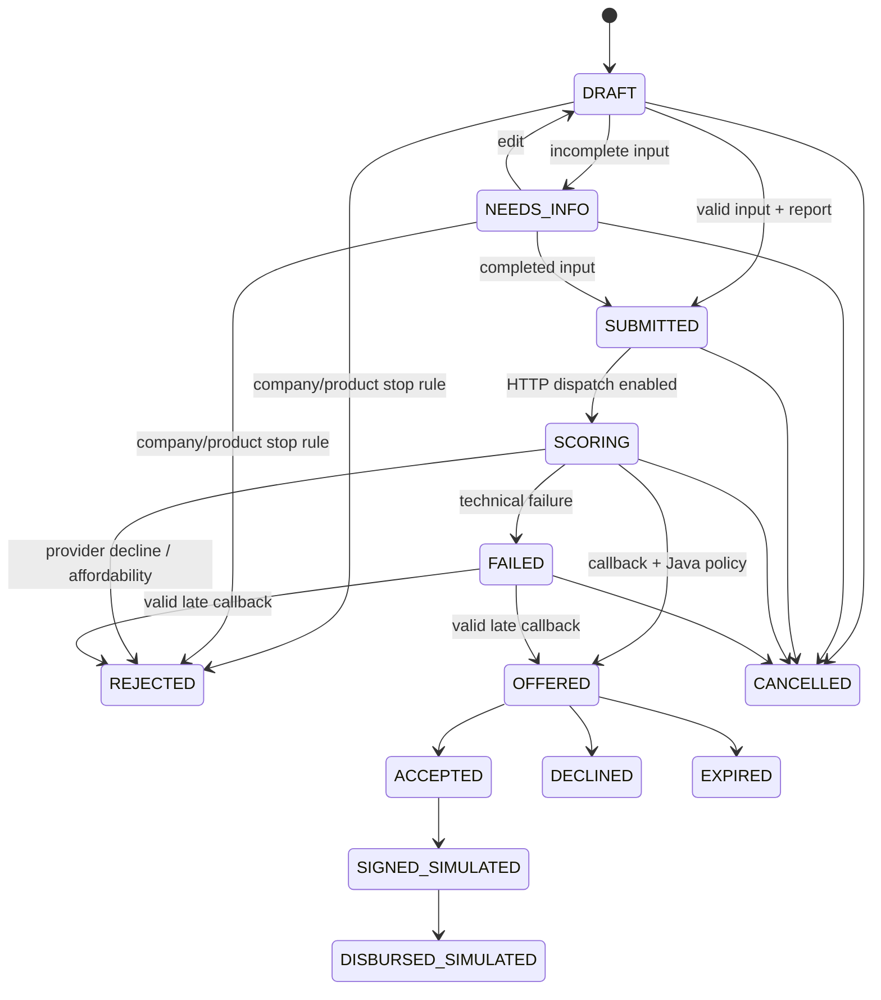

# Java MVP: implemented scope and Python boundary

The Java branch provides the client cabinet, draft and document workflow, durable dispatch queue,
credit policy and offer lifecycle. There is **no local scoring provider, simulated model result or
runtime callback generator**. Python is a separate, future dependency.

## Run

```sh
docker compose --profile app up --build -d --wait
```

Open <http://localhost:8080/login>. Docker and Compose are the only host requirements for this mode.
`postgres` and `app` use persistent database storage. The `app` profile intentionally uses the existing
`dev` authentication keys and synthetic accounts; it is a local review configuration, not a public
production deployment. Native Java development remains available through `start_dev.sh` / `.bat`.
Images for PostgreSQL and Java build/runtime are pinned by digest; the wrapper fixes Maven and the Spring Boot BOM
fixes dependency versions. Initial builds need access to Docker Hub and Maven Central.

Copy `.env.example` to `.env` to override ports or future scorer configuration. An existing database
must pass Flyway validation; migrations V1–V5 are unchanged. Do not repair checksums or delete a
working database to bypass validation: use a separate Compose project for a fresh review environment.

## Main client path, without Python

1. Sign in as `owner@demo.test`, password `DemoCredit2026!`.
2. In **Companies**, fill the registration date and declared status if they are missing. Use synthetic
   values only (for example 2020-01-01 and ACTIVE). These are supplied company data, not results of
   verified external registry calls. Changing the company later does not change a submitted snapshot.
3. Create an application and select a company and a product. No manual UUID entry is required.
4. For example use working capital, RUB 1,000,000, 24 months, monthly payments; revenue 1,000,000,
   expenses 600,000, existing debt payments 10,000 RUB/month. Save the draft.
5. Download the JSON financial-report template, verify its INN and financial figures, and upload it.
   Reports are checked for shape, values, size and agreement with the application. This is a structured
   document check, not OCR or external verification. All uploaded versions remain downloadable.
6. Submit. Missing financials, company data or report produce `NEEDS_INFO` with a specific reason.
   Edit/upload and submit again using the same application UUID.
7. A complete application becomes `SUBMITTED`. With `SCORER_ENABLED=false`, it stays there until
   the future service is connected. This is the expected boundary of the current deployment.
8. Refresh or sign in again: the application, documents and history persist.

The viewer account can read but cannot mutate. The other-company account cannot read, download,
edit or act on this company's application. Lists are scoped to memberships and show the most recent
100 applications. Old applications created before this workflow are readable, with their existing
scoring result, but cannot enter the new offer workflow retroactively.

## Connect the future Python service

```sh
SCORER_ENABLED=true \
SCORER_BASE_URL=http://host.docker.internal:8000 \
SCORER_TOKEN=choose-a-local-shared-token \
docker compose --profile app up --build -d --wait
```

For native Java the URL is normally `http://localhost:8000`. For Python in a Compose container, set
an address resolvable on the shared network. Configure Python's Java callback URL explicitly:
`http://app:8080/scored` in the same Compose network, or `http://localhost:8080/scored` on the host.
The token must match on both sides. It is never passed to the browser. The Java process refuses
an enabled scorer with an empty token.

Existing exchange is preserved:

- Java sends `POST /request`, `X-Scorer-Token`, `{id: <application UUID>, parameters: {...}}`.
- Python must durably save the request and reply **202** before processing asynchronously.
- Identical UUID/input retries must deduplicate; different input under an existing UUID must be 409.
- Python sends `POST /scored` with the shared header and `{id,status,months,percent,sum}`.
  `status` is `OK`, `OFFER` or `DECLINED`; money is RUB, percent is annual percent, months is term.
- Java returns 204 after commit; equal callbacks are idempotent, conflicting results are 409.
- A callback can arrive before the original 202 ACK. A late ACK cannot overwrite a completed task.
- The request is frozen on submission; it includes existing company fields plus `product_id`,
  `financials` (`monthlyRevenue`, `monthlyExpenses`, `existingMonthlyPayment`, all RUB/month),
  and `input_revision`. Extra parameters must be accepted/ignored by a model that does not use them.
- Java does not expect Python to generate documents, maintain user sessions, manage offers or apply
  the Java product policy. The present callback has no model-version field; Java records product and
  policy versions, and keeps the original model result separately from the final decision.

Transport failure, exhausted retries and invalid provider output are technical failures, never credit
rejections. A valid late callback may recover a technically failed request, but cannot reopen a
cancelled application. Existing unsent legacy queue tasks will also run when the worker is enabled.
An invalid provider term outside product limits or annual rate above 60% is rejected with 422, not
silently turned into a credit decline.

## Product and decision policy

| Product | Requested amount, RUB | Term, months | Minimum business age |
| --- | --- | --- | --- |
| Working capital | 100,000–5,000,000 | 6–36 | 6 months |
| Equipment | 500,000–10,000,000 | 12–60 | 12 months |

Purpose must match the product. Quarterly terms must be divisible by three. Profile completeness
and the report are checked before queueing. Declared inactive/too-young businesses are rejected by
explicit Java rules without calling the model. These simplified rules are not a real bank policy.

After a positive callback, available monthly payment is:
`0.5 × (monthlyRevenue − monthlyExpenses) − existingMonthlyPayment`.
For quarterly payments the period budget is three times that amount. The annuity formula uses
the provider's annual rate and term (including a separate zero-rate case). The offered principal is
capped by the request, provider amount, product maximum and affordability. An affordability reduction
is rounded down to RUB 1,000. Below the product minimum, the outcome is `REJECTED` with
`INSUFFICIENT_INCOME`. Conditions are immutable once offered, valid for seven days, and include
amount, annual rate, term, period payment, expiration, product version and policy version.



Signing and disbursement are explicitly labelled simulations, never real signatures or payments.
This does not simulate scoring. A fully positive path requires a real future scorer callback.

## Data and API

- `CreditApplication`: customer/company binding, editable draft parameters, technical state, original
  scorer result. Draft business binding is immutable; submitted parameters cannot be edited by API.
- `CreditApplicationTask`: durable dispatch, exact input snapshot, attempt/lease/timeout metadata.
  `WAITING_INPUT` tasks cannot be claimed. All workflow changes serialize on this queue row.
- `CreditDossier`: business state, financials, product, input revision, frozen submission, decision,
  initial idempotency key and input hash. The unique key is scoped to the creator.
- `CreditDocument`: immutable JSON report bytes up to 1 MiB, SHA-256, revision and upload time.
  Small documents live in PostgreSQL to keep deployment autonomous; no S3 service is required.
- `CreditEvent`: ordered, append-only history with revision, state, reason and relevant input snapshots.

[OpenAPI](../code/app/backend/src/main/resources/openapi/credit.yaml),
[scorer OpenAPI](openapi/scorer.yaml), [Postman collection](requests/credit-mvp.postman_collection.json).
The cabinet OpenAPI is also served at authenticated `GET /api/credit/openapi`.

All client mutations require JWT-cookie authentication and CSRF. `POST /scored` uses only the
service token and its existing separate security chain. The client must fetch `/auth/csrf` after
login because login rotates CSRF. Draft creation requires a UUID `Idempotency-Key`; equal input
returns the same UUID, different input returns 409. Decimal scale differences do not change the key.
The browser retains the create key in sessionStorage across uncertain network responses.

## Verification

```sh
POSTGRES_PORT=5433 docker compose --project-name smartcreditor-dev up -d --wait
cd code/app/backend
DB_URL=jdbc:postgresql://localhost:5433/smartcreditor sh ./mvnw test
```

Integration tests create/drop dedicated random schemas; no developer application data is reset.
Optional browser-helper tests use Node.js 18+: `node --test src/test/js/credit-api.test.cjs`
from the backend directory. Node is not needed by the Java runtime.

JUnit tests exercise the future callback and use an HTTP-client mock **only inside tests**, never as
an application scoring mode. Cases cover idempotency, concurrent creation, incomplete/mismatched
reports, input freezing, all user permissions, CSRF, callback duplicates/conflicts, provider decline,
technical failure, late results, cancellation, offer expiry and repeated lifecycle commands.

## Deliberate limits

No Python runtime/service is added, and no local score or model result is generated. External registry,
FNS and credit-bureau verification are not implemented; supplied company information is declared data.
There is no arbitrary PDF/OCR intake, real legal signing or real disbursement. The earlier architecture
is a broader target; this document describes the actual Java implementation and its explicit limits.
LLM assistance and a separate bank-employee workstation are outside this Java MVP.
