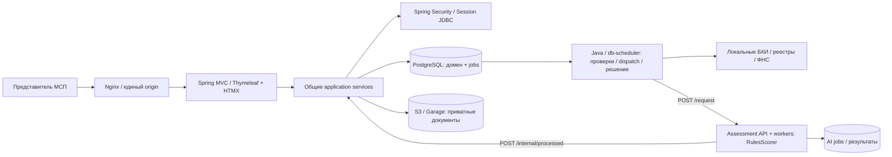
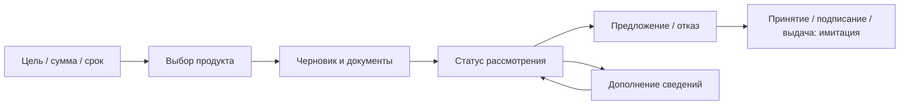
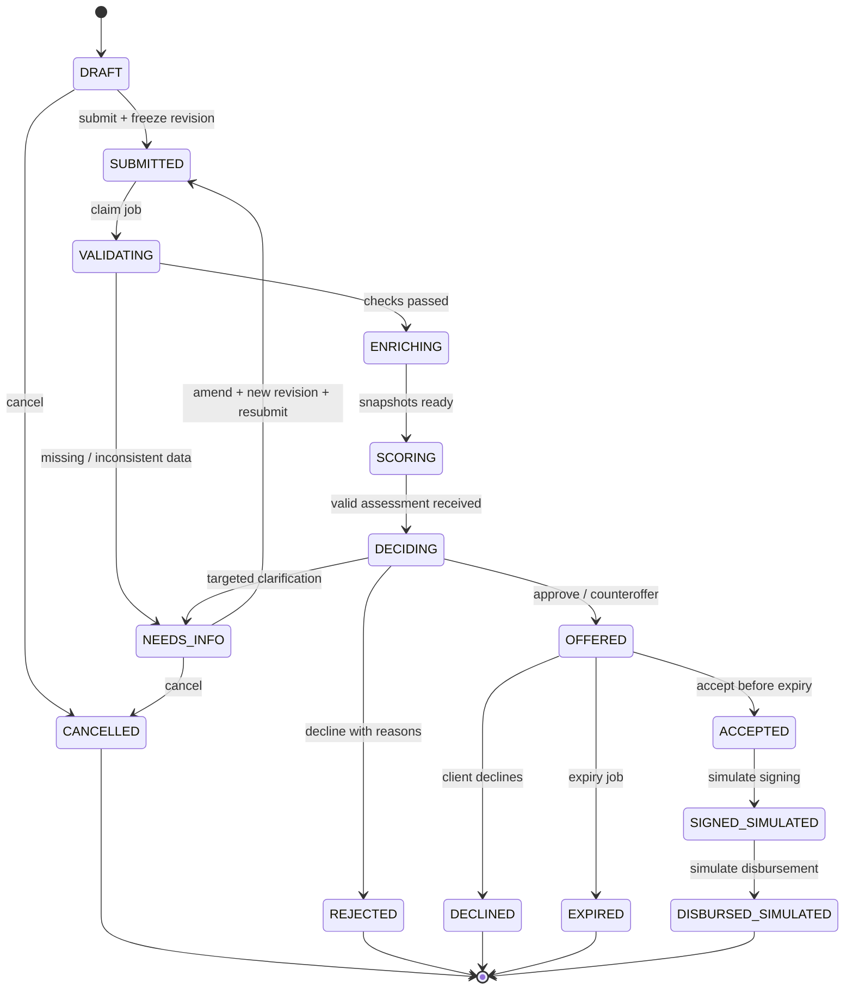
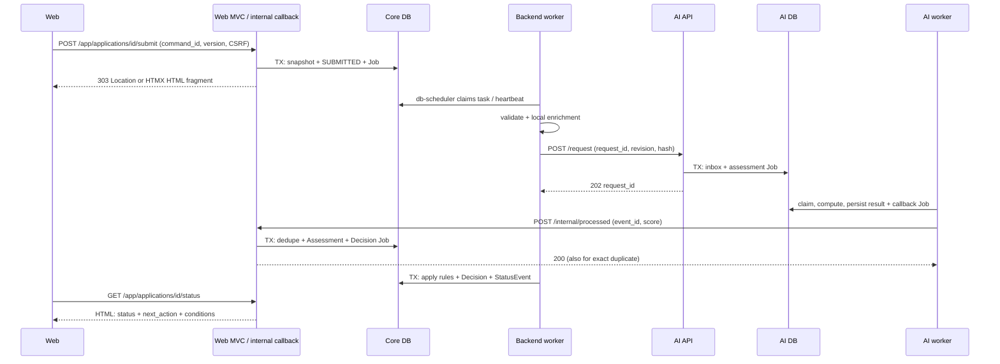
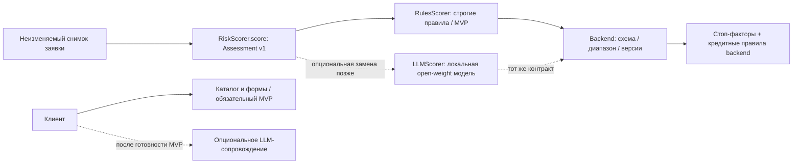
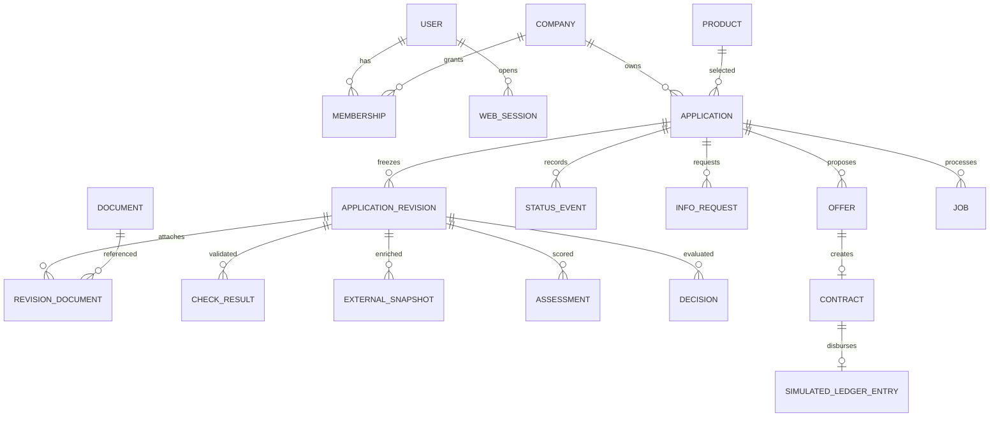
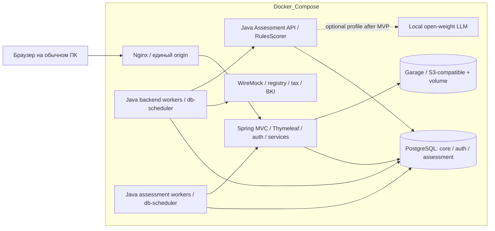

# Умный кредитный кабинет предпринимателя: архитектура MVP

Проектная версия 1.3 • 20.10.2026. Это целевая архитектура, не отчёт о реализации.

Принятый стек: [ADR-0001](../adr/0001-project-stack.md). Основная реализация: Java + Spring Boot; frontend: Thymeleaf + HTMX; миграции: Flyway.

Единственный клиентский вход - веб-интерфейс: [ADR-0002](../adr/0002-web-only-entrypoint.md). Отдельного публичного клиентского JSON API нет; внутренние сервисные контракты сохраняются.

Источники: [требования](../../requirements.md), [исходный PDF](../../requirements.pdf), [preview](../../preview.pdf). Уточнение пользователя исключает новостную ленту. Workers везде означают асинхронные джобы.

## Навигация

1. Кредитный кабинет: полная архитектура
2. Границы MVP и потребности участников
3. Клиентский путь и состав веб-экранов
4. Сквозной банковский процесс
5. Диаграмма состояний заявки
6. Асинхронный контур из preview
7. Проверки, документы и локальное обогащение
8. Скоринг и решение: воспроизводимая модель
9. Скоринг: правила и опциональная LLM
10. Модель данных и связи
11. Данные, версии и транзакционные инварианты
12. Web HTTP-контракты: кабинет и заявки
13. Внутренние контракты и обработка результата
14. Авторизация и безопасность
15. Запуск, Docker и масштабирование
16. Надёжность и наблюдаемость
17. Синтетические сценарии и ожидаемые результаты
18. Тестирование и комплект сдачи
19. Матрица покрытия требований: продукт
20. Матрица покрытия: техника и ограничения
21. Принятый стек проекта

## 01. Кредитный кабинет: полная архитектура

01 / Обзор решения • развитие preview • проектная версия 1.3 • 20 октября 2026

Цель: связать потребность предпринимателя, выбор продукта, заявку и автоматическую банковскую обработку в один проверяемый веб-сценарий. Workers в этом документе всегда означают асинхронные джобы.



| Сохраняем из preview | Уточняем и добавляем |
| --- | --- |
| Backend + auth; S3; polling статуса; два асинхронных контура | БД для доменных данных; durable jobs; идемпотентный callback |
| Каталог /credit; /profile; документы; идея AI-контура | Состояния, кредитные правила, моки; AI-сопровождение после основного MVP |

> Клиентский вход только через web: один набор MVC-контроллеров; внутренние JSON API доступны сервисам. Web/Auth - модули credit-app, workers отдельно. Стек: стр. 21 / ADR-0001; web-only: ADR-0002; матрица ТЗ: стр. 19-20. Это проектная спецификация; новости исключены.


## 02. Границы MVP и потребности участников

02 / Продуктовая модель • роли • исследование

**Клиент.** Собственник, директор, бухгалтер или иной уполномоченный представитель. Для MVP это одна роль с доступом к выбранной компании; принадлежность задаётся синтетическими данными.

**Банк.** Автоматические проверки и кредитные правила. Банковский процесс реализован джобами. Человеческое одобрение и отдельное рабочее место сотрудника не входят в базовый MVP.

**Граница результата.** Клиент получает отказ, запрос сведений или предложение условий. Дополнительно проходит имитацию принятия, подписания и выдачи без реальных денежных операций.

| Гипотеза о потребности | Решение в продукте | Как проверить до защиты |
| --- | --- | --- |
| Не понимаю, какой кредит подходит | Два продукта; цель, сумма и срок; объяснение подбора | Интервью / разбор сценариев: может ли участник выбрать продукт и объяснить выбор |
| Не хочу вводить одни сведения повторно | Профиль компании + черновик; подтверждение ранее сохранённых данных | Пройти две заявки; отметить повторный ввод и потерю контекста |
| Не понимаю, что происходит с заявкой | Текущий этап, история, причины задержки и следующее действие | Попросить участника найти статус и объяснить, что делать дальше |
| Банку нужны воспроизводимые основания решения | Версии входных данных, оценки и правил; журнал событий | Восстановить результат на том же снимке данных |

Исследование ещё нужно провести: зафиксировать сегмент, гипотезы, выбранный метод, реальные наблюдения, выводы и влияние на MVP. План: 3-5 коротких интервью с доступными представителями МСП либо документированный разбор сценариев с честно обозначенными ограничениями. Не выдавать гипотезы за результаты CustDev.

> Сначала весь основной MVP: каталог, формы, документы, строгий скоринг, решение, статусы, запуск и приёмка. Сопровождение клиента и LLMScorer опциональны после готовности MVP; в базе только RulesScorer. Интерфейс замены скоринга проектируем сразу. Новости, мобильное приложение, реальные платежи и залоговые процедуры вне границ.


## 03. Клиентский путь и состав веб-экранов

03 / От потребности до результата • всё взаимодействие внутри продукта



| Экран | Содержимое и действия | Признак готовности |
| --- | --- | --- |
| Вход / выбор компании | Локальные тестовые аккаунты; выбор разрешённой компании | Нет обязательных SMS, писем или внешнего входа |
| Профиль /app/profile | Данные бизнеса; полномочия; редактирование профиля и настроек | Изменения сохраняются и используются в новой заявке |
| Каталог /app/credit | Два продукта; понятные условия и самостоятельный выбор. Сопровождение после MVP | Выбор и подача полностью работают при ASSISTANT_ENABLED=false |
| Новая заявка | Пошаговая форма; черновик; документы; подтверждение отправки | Ошибки привязаны к полям; введённое не теряется |
| Мои заявки / детали | Этап, время события, список документов, запрос недостающих данных | Polling обновляет статус; браузер можно закрыть и открыть |
| Предложение / отказ | Сумма, срок, ставка, платёж; объяснение; принять / отклонить | Альтернативные условия выделены; отказ отличается от технического сбоя |

> Thymeleaf + HTMX + Bootstrap: один набор MVC-контроллеров, серверные формы и фрагменты; polling статуса каждые 2-5 сек. Отдельного клиентского JSON API нет. Показываем текущий этап, историю и действие клиента; нужны загрузка, пустой список, ошибки и повторный вход.


## 04. Сквозной банковский процесс

04 / Бизнес-логика внутри асинхронных джоб

| Этап / исполнитель | Вход → действие | Сохраняемый результат / следующий шаг |
| --- | --- | --- |
| Создание / Web MVC | Компания, продукт, сумма, срок, цель → сохранить черновик | Application + revision; документы связаны с компанией и заявкой; redirect на страницу |
| Отправка / Web MVC | Проверить права, version и command_id → заморозить снимок данных | SUBMITTED + Job в одной транзакции; 303 Location либо HTML-фрагмент для HTMX |
| Валидация / backend worker | Проверить поля, финансовые значения, документы и их согласованность | CheckResult; VALIDATING → NEEDS_INFO либо ENRICHING |
| Обогащение / backend worker | Запросить локальные реестры, ФНС и БКИ по синтетическому ИНН | ExternalSnapshot + версии фикстур; ENRICHING → SCORING |
| Оценка / assessment worker | Вызвать RiskScorer.score(snapshot); в MVP используется RulesScorer | Assessment: provider, model_version, балл, риск, факторы, hash; callback |
| Решение / backend worker | Сопоставить риск, допустимость продукта и долговую нагрузку | Decision + reasons + версия правил; DECIDING → OFFERED / REJECTED / NEEDS_INFO |
| Ответ / Web + Backend | Показать историю, результат и дальнейшие действия | Offer / InfoRequest; клиент принимает, отклоняет или дополняет сведения |
| После одобрения / Backend | Принять неизменённое предложение → сгенерировать договор | ACCEPTED → SIGNED_SIMULATED → DISBURSED_SIMULATED; все операции идемпотентны |

> Backend единолично управляет бизнес-состоянием. AI возвращает оценку, но не меняет заявку напрямую и не принимает окончательное кредитное решение. Статус SCORING сохраняется до приёма валидного результата; готовый callback создаёт джобу решения.


## 05. Диаграмма состояний заявки

05 / Допустимые переходы • техническая обработка учитывается отдельно



Для читаемости на схеме не показана дополнительная стрелка NEEDS_INFO → CANCELLED; она разрешена. DECLINED и EXPIRED - два разных терминальных статуса, объединённых только визуально.

> Техническое состояние хранится отдельно: IDLE / RUNNING / RETRY_WAIT / FAILED. Сбой сервиса не переводит заявку в REJECTED. При FAILED показываем техническую задержку; оператор демо может повторить job. Проверка version и revision не допускает устаревшие и произвольные переходы.


## 06. Асинхронный контур из preview

06 / Inbox в БД • два набора workers • доставка с повторениями



| Ситуация | Гарантия в MVP |
| --- | --- |
| Worker упал / контейнер перезапущен | db-scheduler хранит задания в PostgreSQL и восстанавливает зависшие исполнения по heartbeat. Другой worker продолжает; обработчики идемпотентны. |
| Внутренний POST: ответ потерян | Повтор с тем же request_id и payload hash возвращает прежний результат; иной payload с тем же ключом → 409. |
| Callback повторился / пришёл поздно | UNIQUE(event_id); проверка application revision, request_id и статуса; устаревший результат сохраняется как ignored. |
| Ошибка и повтор | Backoff 2/5/15/30/60 сек: до 5 повторов; затем доменный FAILED + журнал + replay. Heartbeat и recovery настраиваются средствами db-scheduler. |

> Исполнитель - db-scheduler; его scheduled_tasks хранит очередь и heartbeat. Доменный Job хранит связь с заявкой, статус и диагностику; второго самописного polling нет. Submit и постановка задачи - одна транзакция. Доставка at-least-once; повторные вызовы дают однократный бизнес-эффект.


## 07. Проверки, документы и локальное обогащение

07 / Синтетические данные • воспроизводимые интеграции

| Проверка / источник | Что проверяем или получаем | Результат и поведение |
| --- | --- | --- |
| Форма и бизнес-поля | Типы, обязательные поля, ИНН, положительные суммы, срок, расходы и доходы | Ошибки формата → 422 до submit; бизнес-неполнота → NEEDS_INFO с перечнем полей |
| Документы | Тип, обязательность, размер до 10 МБ, MIME и сигнатура файла, checksum; шаблонные демо-формы | DocumentCheck: valid / missing / inconsistent; запросить замену или дополнение |
| Согласованность | ИНН в форме и документе; единый период и непротиворечивость финансов; версия документа | Не подменять неизвестные цифры нулями; конфликт → адресный запрос сведений |
| Мок ЕГРЮЛ / ЕГРИП | Существование бизнеса, статус, дата регистрации, ОКВЭД | RegistrySnapshot; неактивный бизнес → причина отказа по демо-правилам |
| Мок ФНС / «Прозрачный бизнес» | Сведения о компании, руководителе, адресе, флаги расхождений | TaxSnapshot; существенное расхождение → NEEDS_INFO; технический сбой → retry |
| Мок БКИ | Текущие обязательства, месячный платёж, максимальная просрочка за 12 месяцев | CreditHistorySnapshot; факторы риска и стоп-факторы; source + fixture_version |

**Загрузка.** Backend авторизует запрос и принимает файл, сохраняет в приватный bucket, затем метаданные. Привязка документа к заявке проверяется по company_id. Незавершённые объекты чистит отдельная job.

**Хранение и чтение.** Core DB хранит object_key, checksum, тип, размер, revision и владельца. Доступ к файлу только через авторизованный backend. Публичные URL и прямой доступ к bucket не нужны.

**Автономность.** Моки - локальные endpoints с JSON-фикстурами по ИНН. Поддерживают успех, отсутствие записи и сбой. В проверяемой версии нет вызовов настоящих банковских или государственных систем.

> Распознавание произвольных сканов не является требованием ТЗ. В MVP используем синтетические PDF/JSON установленной структуры и ввод финансовых показателей в форме; файлы и суммы сопоставляются по шаблону. OCR можно добавить отдельно, обозначив его точность и ограничения.


## 08. Скоринг и решение: воспроизводимая модель

08 / Все числа ниже - синтетические проектные правила, а не политика Альфа-Банка

| Фактор риска | Баллы | Особый случай |
| --- | --- | --- |
| Возраст бизнеса | ≥24 мес: 0; 12-23: 10; 6-11: 20 | <6 мес → стоп-фактор |
| Маржа = (доходы - расходы) / доходы | ≥20%: 0; 10-<20%: 10; 0-<10%: 20 | Доходы ≤0 или чистый доход ≤0 → стоп-фактор |
| Действующий месячный долг / чистый доход | ≤20%: 0; >20-40%: 15; >40%: 30 | Отсутствующие показатели → запрос сведений |
| Максимальная просрочка за 12 месяцев | 0 дней: 0; 1-30: 15; 31-90: 35 | >90 дней или неактивный бизнес → стоп-фактор |

Assessment service суммирует баллы: 0-39 = LOW, 40-79 = MEDIUM, ≥80 = HIGH. Backend применяет стоп-факторы и правила продукта. HIGH → отказ; MEDIUM → максимальная сумма продукта × 0,5; LOW → полный лимит. Версии score_v1 и decision_v1 сохраняются вместе с результатом.

| Демо-продукт | Сумма / срок / ставка | Ограничения решения |
| --- | --- | --- |
| Оборотный | 100 тыс. - 3 млн ₽; 6-24 мес.; 18% годовых | Возраст ≥6 мес.; (старый платёж + новый платёж) / чистый доход ≤45% |
| Оборудование | 500 тыс. - 10 млн ₽; 12-60 мес.; 16% годовых | Возраст ≥12 мес.; тот же коэффициент ≤50%; залог в MVP не моделируется |

Новый платёж: A = P × r / (1 - (1+r)^(-n)), где r = годовая ставка / 12, n = срок в месяцах. Доступный платёж = max(0, лимит нагрузки × чистый доход - старый платёж). Обратной формулой получаем доступную сумму, округляем вниз до 1 000 ₽ и ограничиваем лимитом продукта и риска.

> Порядок: неполные данные → NEEDS_INFO; стоп-фактор / HIGH / недопустимый продукт → REJECTED; запрос укладывается в лимиты → OFFERED; иначе предложить меньшую сумму при том же сроке, если она ≥ минимума продукта. Если допустимой суммы нет - отказ с reason_code. Автосмены продукта и срока в MVP нет; клиент может создать новую заявку.


## 09. Скоринг: правила и опциональная LLM

09 / Базовый MVP без LLM • заменяемый провайдер • сопровождение после MVP



| Приоритет / функция | Контракт и граница |
| --- | --- |
| MVP / RulesScorer | RiskScorer.score(input) → Assessment v1. Детерминированные факторы и баллы со стр. 08; SCORING_PROVIDER=rules. Провайдер и версия фиксируются при создании assessment job. |
| Опция / LLMScorer | Будущий адаптер с тем же входом и выходом; внешний /request и состояния заявки сохраняются. score: целое 0-105; risk_band согласован с порогами; factors, provider и model_version обязательны. |
| Опция / сопровождение | Реализуем только после завершения остального MVP. ASSISTANT_ENABLED=false; чат и /app/assistant не нужны для подачи. Включённый помощник объясняет поля, продукты и недостающие сведения. |
| Условие включения LLM | Локальные открытые веса; зафиксированы модель, ревизия, лицензия, checksum и ресурсы. LLMScorer включается после contract-тестов и проверки на синтетических сценариях; в базовой версии его адаптера нет. |

> Backend проверяет результат и независимо вычисляет стоп-факторы и продуктовые ограничения. Некорректный LLM-ответ → ошибка обработки / retry, без одобрения и скрытой подмены провайдера. Инструкции из документов не исполняются; значения берутся из подтверждённых данных. Для повторного расчёта другим провайдером нужен новый request_id; прежняя оценка сохраняется.


## 10. Модель данных и связи

10 / PostgreSQL - источник истины • S3 - содержимое документов



> ERD в Markdown раскрывает связи. Assessment и Decision относятся к revision. InboxEvent дедуплицирует; AuditEvent фиксирует доступ. Spring Session JDBC хранит WebSession в auth; scheduled_tasks - задания db-scheduler. AIRequest/AIJob/AIResult относятся к assessment-схеме. Документы хранятся в Garage.


## 11. Данные, версии и транзакционные инварианты

11 / Защита от потери контекста и противоречивых результатов

| Сущность | Обязательные поля / ограничения |
| --- | --- |
| Application | UUID; company_id; applicant_id; product_id + product_version; status; processing_state; current_revision; version; timestamps |
| ApplicationRevision | application_id + revision UNIQUE; сумма в копейках; RUB; срок в месяцах; цель; данные компании; финансы с периодом; document_refs; payload_hash; frozen_at |
| Check / Snapshot | application_id; revision; check_type / source; outcome; reason_codes; fixture_version; response_hash; completed_at |
| Assessment / Decision | request_id UNIQUE; revision; provider; model_version; schema_version; score; risk_band; factors; stop_flags; Decision: assessment_id, rule_version, product_version, reasons |
| Offer / InfoRequest | Offer: immutable amount / term / annual_rate / monthly_payment / expires_at / status. InfoRequest: поля, документы, текст причины, ответ клиента |
| Job / InboxEvent | Job: id; kind; dedup_key UNIQUE; application_id; revision; request_id; status; error_code. scheduled_tasks: очередь, повторы и heartbeat. Inbox: event_id UNIQUE + payload_hash |
| Audit / StatusEvent | actor_type + actor_id; application_id; from_status; to_status; revision; trace_id; timestamp; безопасный набор изменённых полей |

**Изменение данных.** Формы передают скрытые version и command_id. Version защищает от конфликта, command_id - от повторного эффекта. После submit снимок неизменяем; в NEEDS_INFO создаётся следующая revision; история сохраняется.

**Атомарность.** Submit + revision + status + job коммитятся вместе. Callback: inbox + assessment + job решения одной транзакцией. Decision + offer + status + event также атомарны.

**Денежные операции.** В Java BigDecimal; в БД целые копейки; ставки decimal. Принятие проверяет срок предложения. Договор и имитация выдачи имеют уникальный ключ по offer / contract.

> Все бизнес-запросы ограничены membership.company_id. Пользователь не выбирает company_id произвольно. Повтор одной и той же команды возвращает сохранённый результат; конфликт версии → 409. Удаление или замена файла не меняют уже отправленную revision.


## 12. Web HTTP-контракты: кабинет и заявки

12 / Клиент использует только web • один набор MVC-маршрутов • без JSON-дублей

| Метод / путь | Назначение | Ответ / проверка |
| --- | --- | --- |
| GET/POST /login; POST /logout | Вход и выход через Spring Security | Сессия; CSRF; redirect на кабинет; без SMS |
| GET/POST /app/profile | Сведения пользователя и настройки | HTML-форма; собственный профиль; скрытая version |
| GET /app/companies; GET/POST /app/companies/{id} | Выбор компании и бизнес-профиль | Membership; version; чужая компания → 403/404 |
| POST /app/documents; GET /app/documents/{id}/content | Загрузка и скачивание документов | Multipart → HTML/redirect; скачивание файла после проверки прав |
| GET /app/credit; GET /app/credit/{product_id} | Каталог и условия продукта | HTML-карточки; начало заявки по выбранному продукту |
| GET/POST /app/assistant [после MVP] | Помощь с выбором и подачей | ASSISTANT_ENABLED=false: маршрут выключен, чат скрыт |
| GET/POST /app/applications | Список заявок; создать черновик | HTML-список / форма; создать → redirect на черновик |
| GET/POST /app/applications/{id} | Детали и сохранение черновика/уточнений | HTML; version + command_id; проверка допустимого состояния |
| POST /app/applications/{id}/submit | Отправить сохранённую заявку | CSRF; version; command_id; 303 либо HTMX-фрагмент |
| GET /app/applications/{id}/status; .../history | Карточка этапа и история событий | HTML-фрагмент; polling 2-5 сек; понятное следующее действие |
| POST /app/applications/{id}/resubmit; .../cancel | Дополнить сведения; отменить | Новая revision из NEEDS_INFO; cancel из DRAFT/NEEDS_INFO |
| GET /app/offers/{id}; POST .../accept; .../decline | Просмотр и ответ на предложение | HTML-условия; OFFERED; expires_at; command_id |
| GET /app/contracts/{id}; POST .../sign-simulated | Договор и имитация подписи | Файл/страница договора; явная имитация; command_id |
| POST /app/contracts/{id}/disburse-simulated | Имитировать выдачу после подписи | Однократная запись ledger; HTML-результат; реальных платежей нет |

> Формы: urlencoded/multipart. Успех: 303 или HTMX HTML. Ошибки: HTML, включая 422. OpenAPI описывает эти же маршруты без JSON-дублей. Подробности: ADR-0002.


## 13. Внутренние контракты и обработка результата

13 / Корреляция • проверка схем • интеграционные границы

| Контракт | Вход / выход | Гарантия |
| --- | --- | --- |
| AI: POST /request | request_id; application_id; revision; input_hash; schema_version; financials; snapshots; provider; model_version | 202 после commit; provider/version включены в hash; в MVP только rules; иной payload с тем же request_id → 409 |
| AI: GET /requests/{request_id} | PENDING / RUNNING / SUCCEEDED / FAILED; сохранённый result при готовности | Reconciliation backend при потерянном callback; не создаёт вторую оценку |
| Backend: POST /internal/processed | event_id; request_id; application_id; revision; input_hash; schema_version; score; risk_band; factors; stop_flags; provider; model_version | Схема, диапазон и ожидаемые provider/version; дедупликация; Assessment + decision job одной транзакцией |
| Mocks: GET /registry/{inn}; /tax/{inn}; /bki/{inn} | Версионированный JSON, фикстуры и режим сбоя | Доступны только внутри Docker network; неизвестный ИНН → явный NOT_FOUND |
| GET /actuator/health/liveness; .../readiness | Жив ли процесс; готова ли БД / обязательные зависимости | Actuator probes; readiness закрыт до миграций; без секретов в ответе |

```json
{
  "event_id": "evt-score-demo-01", "request_id": "req-demo-01",
  "application_id": "app-demo-01", "revision": 1,
  "input_hash": "sha256:<canonical-input>", "schema_version": 1,
  "provider": "rules", "model_version": "score_v1",
  "score": 0, "risk_band": "LOW",
  "factors": [{"code": "BUSINESS_AGE", "points": 0}],
  "stop_flags": []
}
```

> Пример иллюстрирует поля, а не готовую OpenAPI-схему; factors должен содержать все рассчитанные факторы. Backend принимает callback только для ожидаемого request_id текущей revision. Точный дубликат → 200; неизвестный request → 404; конфликт hash → 409; устаревший результат → 200 ignored с записью в аудит.


## 14. Авторизация и безопасность

14 / Spring Security + Session JDBC • права компании • CSRF для Thymeleaf

**Auth без внешних зависимостей.** Spring Security; локальные аккаунты; стойкий password hash. Cookie указывает на сессию Spring Session JDBC в PostgreSQL. При входе меняется session id; logout инвалидирует сессию. Клиент работает только в браузере.

**Полномочия.** MVC проверяет доступ к компании, заявке, документу, offer и contract; services обеспечивают доменные ограничения. Assessment service использует отдельные service credentials; его JSON API закрыт от клиентского входа.

**Граница сети.** В браузер опубликован один gateway. Core DB, AI DB, S3, mocks и внутренний callback находятся в закрытой сети. Cloud ingress использует HTTPS; локальный HTTP разрешён только для демо на localhost.

| Риск / зона | Проектная мера и проверка |
| --- | --- |
| Доступ к чужой заявке или файлу | Проверка object ownership независимо от UUID; негативный тест для каждой группы ресурсов |
| Cookie, сессия и браузер | Session-cookie HttpOnly, SameSite и Secure в HTTPS; CSRF на изменяющих web-запросах; Thymeleaf передаёт токен в формах, HTMX - в заголовке; без credentials в URL/логах |
| Внутренний /processed | Сервисный секрет в заголовке + сетевое ограничение; сравнение без утечек; поддельный callback → 401; ключи через env / secret file |
| Файлы и ввод | Ограничение MIME / размера / сигнатуры; generated object_key; параметризованные SQL; schema validation; текст документов не исполняется |
| Зависимости и конфигурация | Lock-файлы, фиксированные образы, непривилегированные контейнеры, секреты вне Git; демо-значения явно помечены |
| Аудит и данные | Синтетические сведения; журнал действий и решений; snapshots неизменяемы; без паролей, session id, секретов, файлов и полных payload в логах |

> Web - единственный клиентский вход. Spring Session JDBC поддерживает несколько экземпляров без sticky sessions. Auth - модуль credit-app. Nginx не публикует внутренние JSON endpoints; для них отдельные service credentials и точечные CSRF-исключения. См. ADR-0001/0002.


## 15. Запуск, Docker и масштабирование

15 / Проверяемый локальный профиль • Kubernetes как путь развития preview



| Область | Решение / критерий приёмки |
| --- | --- |
| Единый запуск | Целевой контракт: docker compose up --build; healthchecks → migrate → seed → ready. README фиксирует Docker, ресурсы и переменные. Это команда будущей реализации. |
| Базовый профиль | CPU без LLM и платных сервисов; PostgreSQL с core/auth/assessment и отдельными DB-ролями; Garage + WireMock локально; клиентский web отдельно от workers |
| Ресурсы и версии | Плановый бюджет: 4 CPU / 8 ГБ RAM, подтвердить замером. До сдачи фиксировать JDK, Maven Wrapper, BOM и зависимости в pom.xml, image tags/digests и модели. |
| Kubernetes / облако | Не обязателен в MVP. Те же контейнеры: Deployments API/workers/auth, Services, Ingress, readiness, requests/limits; stateful storage с backup. Внешний бесплатный стенд желателен. |

> Конфигурация: JDBC URLs core/auth/assessment; S3_ENDPOINT / BUCKET / REGION / PATH_STYLE / credentials; service token; MOCK_MODE; SEED_PROFILE; SCORE_VERSION; RULE_VERSION. SCORING_PROVIDER=rules; ASSISTANT_ENABLED=false. Flyway управляет схемами; JPA ddl-auto=validate. Garage меняется конфигурацией, прежние объекты переносятся отдельно.


## 16. Надёжность и наблюдаемость

16 / Отказоустойчивость должна быть видна и проверяема

| Ситуация | Поведение системы | Что проверяем / наблюдаем |
| --- | --- | --- |
| API перезапущен | Статус и данные читаются из PostgreSQL; незавершённые команды повторяются с ключом | GET возвращает прежние данные; нет дублирования заявки |
| Worker остановлен | Заявка ожидает; db-scheduler сохраняет задание; после recovery работа возобновляется | Возраст очереди, heartbeat age, retries; UI показывает этап |
| Мок / AI временно недоступен | Timeout → backoff; исчерпание попыток → FAILED, без кредитного отказа | reason_code технической ошибки; replay job; длительность этапа |
| Callback потерян | AI повторяет доставку; backend сверяет зависшие request_id через GET /requests | Уникальная оценка и единственное решение; счётчик duplicate / ignored |
| БД недоступна | API не подтверждает submit; rollback; readiness=false; worker не подтверждает job | 503; данные и очередь не расходятся после восстановления |
| S3 недоступно | Не объявлять загрузку успешной; безопасно повторить; незавершённый объект очистить | Нет metadata со статусом READY без подтверждённого файла |
| Два ответа клиента одновременно | Optimistic locking + блокировка offer в транзакции; один допустимый переход | Accept/decline не применяются оба; выдача не повторяется |

**Логи.** Структурированный JSON: timestamp, service, trace_id, job_id, application_id, revision, event, duration, error_code. Корреляция проходит через API, jobs и callback; без секретов и payload документов.

**Метрики.** Actuator + Micrometer: заявки по этапам, возраст очереди, длительность, retries, failed jobs, callback lag и ошибки интеграций. Health и метрики доступны внутри сети; просмотр описан в README.

**Сохранность.** Persistent volumes; миграции схем; backup PostgreSQL и bucket; описанный restore на синтетическом наборе. В облаке добавляются репликация и алерты, но они не заменяют транзакционные гарантии.

> Основные инварианты: у одного submit один бизнес-эффект; один актуальный assessment на ожидаемый request; один действующий offer; одна имитация выдачи на договор. Масштабирование workers не меняет результат на том же снимке данных.


## 17. Синтетические сценарии и ожидаемые результаты

17 / Данные для экспертов • проверяемые числа • без реальных клиентов

| Фикстура | Данные и запрос | Ожидаемый результат |
| --- | --- | --- |
| A / стабильный бизнес | 36 мес.; доход 1 млн, расход 600 тыс. ₽/мес.; долг 50 тыс./мес.; просрочка 0; оборотный 1 млн на 12 мес. | Балл 0 / LOW. Платёж ≈91 680 ₽; нагрузка ≈35,42% <45%. OFFERED на исходных условиях. |
| B / негативная история | Те же финансы, но максимальная просрочка 120 дней в мок-БКИ | Стоп-фактор OVERDUE_GT_90; REJECTED. Причина объясняется клиенту; технической ошибки нет. |
| C / неполные сведения | У A отсутствует обязательный отчёт; затем клиент загружает демо-документ | NEEDS_INFO с конкретным документом → revision 2 → SUBMITTED → OFFERED; история revision 1 сохранена. |
| D / альтернативная сумма | Данные A; запрос оборотного 3 млн на 24 мес. | Доступный платёж 130 тыс. ₽; максимальная сумма ≈2,603953 млн. OFFERED / COUNTEROFFER: 2 603 000 ₽, срок 24 мес. |
| E / разные продукты | Данные A; 2 млн на 24 мес. для каждого продукта | Риск одинаков: 0 / LOW. Ставка, платёж и лимит нагрузки различаются по продуктам; обе заявки оцениваются отдельными правилами. |
| F / средний риск | 18 мес.; доход 1 млн, расход 850 тыс.; долг 40 тыс./мес.; просрочка 15 дней; оборотный 290 тыс. на 12 мес. | 10+10+15+15 = 50 / MEDIUM. Лимит суммы снижен до 1,5 млн; нагрузка ≈44,39% → допустимое предложение. |

Seed создаёт минимум два клиентских аккаунта с разными компаниями, два версионированных продукта, набор компаний и финансов, фикстуры трёх источников, синтетические документы и режимы отказа. Идентификаторы, логины, пароли и соответствия сценариев публикуются в инструкции демо; реальные данные не используются.

> Проверка A продолжается до ACCEPTED → SIGNED_SIMULATED → DISBURSED_SIMULATED; клиент видит договор и отметки имитации. Числа округлены для отображения; эталон в Java рассчитывается BigDecimal по формуле стр. 08, платёж округляется до копеек.


## 18. Тестирование и комплект сдачи

18 / Артефакты, которые эксперт сможет запустить и проверить

| Группа проверок | Минимальные тесты / доказательство |
| --- | --- |
| Unit / доменная логика | Границы риска и стоп-факторов; обе политики; формулы; контрпредложение; переходы и сроки offer. Contract-тест RiskScorer на RulesScorer и stub: schema, provider/version, диапазон, некорректный ответ |
| Integration / API и jobs | Submit + job атомарны; рестарт worker; дедупликация submit/request/callback; конфликт hash; stale revision; недоступность AI/мока; повторная выдача |
| Security / негативные | Чужие company/application/document/offer; истёкшая сессия; отсутствующий CSRF; поддельный callback; недопустимые файлы; отсутствие credentials в логах |
| End-to-end / UI | A: выбор → профиль → документы → submit → статус → offer → имитации. B: отказ. C: дополнение. D: иные условия. Отдельно reload браузера и повторный вход. |
| Deployment / воспроизводимость | Чистое окружение + одна команда; миграции и seed; E2E с ASSISTANT_ENABLED=false и SCORING_PROVIDER=rules; без LLM и платных ключей; restart и backup/restore |

| Обязательный материал | Предлагаемое место в будущем репозитории |
| --- | --- |
| Назначение, запуск, конфигурация, компоненты, walkthrough | README.md; .env.example; compose.yaml; Dockerfile; Maven Wrapper; pom.xml с BOM и фиксированными версиями |
| Архитектура, состояния, модель данных | docs/architecture/architecture.md + PDF; docs/data-model.md; миграции; уточнённые ADR |
| HTTP-контракты + OpenAPI/Swagger + коллекция | docs/api.md; openapi/web.yaml (form/HTML); openapi/internal.yaml (JSON); docs/requests/collection.json |
| Синтетические данные и тестовые сценарии | seed/; fixtures/; demo/accounts.md; docs/test-scenarios.md; tests/; demo/walkthrough.md |
| Компоненты, модели, датасеты, сервисы, моки | THIRD_PARTY_NOTICES: версии / лицензии / происхождение / пометки симуляций |
| Исследование, решения и идентификатор версии | docs/research.md; ADR-0001 (стек); ADR-0002 (web-only); GitHub history; тег/commit; доступ alfa-hack-2026 для private repo |

> Названия выше - план структуры, не утверждение о наличии файлов. Перед дедлайном: все проверки пройдены на выбранном commit; зафиксированы версия и доступ жюри. Коммиты после дедлайна не учитываются. Бесплатный облачный стенд и запись демо могут дополнять локальный запуск.


## 19. Матрица покрытия требований: продукт

19 / Проверяемая трассировка • требование → архитектура → доказательство

| ID / требование ТЗ | Где раскрыто | Доказательство при приёмке |
| --- | --- | --- |
| P01 / исследование потребностей МСП | Стр. 02: гипотезы, роли, способ исследования | docs/research.md: наблюдения → решения; ограничения исследования |
| P02 / границы, этапы, участники, данные, результаты | Стр. 02, 04-05, 10-11 | Описание MVP + диаграмма состояний + модель данных |
| P03 / личный веб-кабинет и выбор продукта | Стр. 03, 08-09, 12 | E2E A и E: выбор продукта и сохранение контекста |
| P04 / путь от заявки до результата | Стр. 03-05, 17 | E2E A/B/C/D: одобрение, отказ, дополнение, иные условия |
| P05 / внутренняя банковская обработка | Стр. 04, 06-08: асинхронные джобы | История проверок, снимки источников, оценка и решение |
| P06 / сохранение и повторное использование данных | Стр. 10-11: revisions и persistent storage | Reload / restart / новая заявка используют сохранённые данные |
| P07 / реакция на действия и динамические статусы | Стр. 03, 05, 12: polling + next_action | После submit / resubmit / accept состояние меняется в UI |
| P08 / проверка полноты и корректности | Стр. 07: schema + бизнес-проверки | Ошибки полей; C: запрос документа и повторное рассмотрение |
| P09 / внутренние и внешние сведения | Стр. 07, 13: локальные БКИ, реестры и ФНС | Фикстуры и source_version видны в trace; сбои повторяются |
| P10 / риск отдельно от кредитного решения | Стр. 08-09: assessment → backend rules | E: один риск, разные условия продуктов; сохранены обе версии |
| P11 / результат и дальнейшие действия | Стр. 03-05, 08, 17 | Условия, reason_codes, InfoRequest; явные имитации после одобрения |
| P12 / UX без банковской экспертизы | Стр. 02-03: объяснение, текущий этап, действие | Сценарный UX-разбор; понятные причины и отсутствие тупиков |
| P13 / обоснование MVP и потенциал развития | Стр. 02, 09, 14-16 | ADR: RulesScorer в MVP; LLMScorer и сопровождение позже; jobs в БД; развитие до K8s |

> Статус каждой строки сейчас: СПРОЕКТИРОВАНО. После реализации команда добавляет ссылки на код, тесты и артефакты. Обогащение и формы результата в ТЗ описаны как пространство вариантов; здесь они включены в выбранный MVP для наглядного полного процесса. Наличие ручного сотрудника не требуется для такого сценария.


## 20. Матрица покрытия: техника и ограничения

20 / Сдача • автономность • enterprise-подходы • ограничения проекта

| ID / требование ТЗ | Решение в архитектуре | Доказательство при приёмке |
| --- | --- | --- |
| T01 / GitHub, история, версия на дедлайн, доступ жюри | Стр. 18: commit / tag; alfa-hack-2026 | Репозиторий доступен; указан проверяемый hash |
| T02 / cloud-native, Docker, обычный ПК | Стр. 15: Compose; state вне API; healthchecks | Одна команда на чистом ПК; фактические ресурсы в README |
| T03 / версии языка и ключевых библиотек | Стр. 15, 18, 21: Maven Wrapper, BOM, images | Сборка воспроизводима на зафиксированной версии |
| T04 / README: цель, архитектура, запуск, конфигурация | Стр. 15, 18: структура и env inventory | Эксперт проходит walkthrough самостоятельно |
| T05 / синтетические данные и учётные записи | Стр. 07, 17-18: seed, fixtures, accounts | E2E A-F без подготовки реальных данных |
| T06 / THIRD_PARTY_NOTICES и моки | Стр. 09, 18: компоненты / модели / данные / сервисы | Версии, лицензии, происхождение; симуляции перечислены |
| T07 / архитектура, API, Swagger, коллекция, состояния, данные, тесты | Стр. 01, 05, 10-13, 18; ADR-0002 | OpenAPI form/HTML + internal JSON; коллекция использует реальные маршруты |
| T08 / независимость от платных ресурсов и корпсистем | Стр. 07, 09, 15: локальные сервисы и моки | Нет обязательных внешних API-ключей и подписок |
| T09 / только синтетические данные | Стр. 07, 14, 17: фикстуры и документы | В seed, логах, скриншотах нет реальных персональных данных |
| T10 / основной сценарий внутри продукта | Стр. 03, 14: локальный вход и запрос сведений | Нет обязательных писем, SMS, мессенджеров и звонков |
| T11 / LLM только с открытыми весами | Стр. 09: две независимые опции после MVP | База без LLM; при включении зафиксированы модель, ревизия и лицензия |
| T12 / web; допустимые упрощения и имитации | Стр. 02-03, 07-09, 12, 17 | Реальный интерактивный UI; ограничения и имитации видны |
| T13 / безопасность, надёжность, масштабирование, сопровождение | Стр. 06, 11, 14-16, 18 | Негативные тесты; restart/retry; audit; миграции; backup/restore |
| T14 / бесплатный внешний стенд желателен | Стр. 15, 18: дополнительный профиль | Доступный URL и тестовый вход при наличии стенда |

> Новости исключены по уточнению requirements.md. Источники: requirements.md, requirements.pdf с уточнением и preview.pdf. Допущения: два продукта, CPU-база без LLM, автоматическое решение, локальные моки, синтетические правила и операции. Стек принят в ADR-0001; точные версии фиксируются при создании рабочего каркаса.


## 21. Принятый стек проекта

21 / Решение пользователя • Spring Boot + Thymeleaf • ADR-0001 • версии уточняются при реализации

| Часть | Выбранная технология | Граница ответственности |
| --- | --- | --- |
| Язык / сборка | Java 21 LTS; Maven Wrapper | Одна кодовая база с модулями credit, assessment и общими контрактами |
| Web / HTTP | Spring Boot; MVC; Bean Validation | Один набор web-контроллеров; прямой вызов application services |
| Frontend | Thymeleaf + HTMX + Bootstrap | Страницы /app/**; серверные формы; polling статусов и частичные обновления |
| Данные / миграции | PostgreSQL; JPA/Hibernate; Flyway | Доменные данные, JDBC для специальных запросов; схемой управляет Flyway |
| Auth | Spring Security; Spring Session JDBC | Сессия в PostgreSQL; HttpOnly-cookie; CSRF; company membership |
| Фоновые задания | db-scheduler + PostgreSQL | Единственный job runtime; отдельные Java workers; retry/recovery и идемпотентность |
| Скоринг | Java RulesScorer / RiskScorer | Строгие правила в MVP; LLMScorer и сопровождение после остальных функций |
| Документы | Garage; AWS SDK for Java v2 | DocumentStorage.put/get/delete; endpoint из env; object_key в БД |
| Моки / HTTP docs | WireMock; OpenAPI; springdoc; Swagger UI | Web.yaml для форм/HTML; internal.yaml для JSON; моки БКИ/ФНС/реестров |
| Проверки / метрики | Spring Boot Test; Testcontainers; Playwright; Actuator/Micrometer | JUnit/contract, интеграции, E2E; health, JSON-логи и метрики |
| Развёртывание | Docker Compose; Nginx | Единый web-вход; persistent volumes; web и workers запускаются отдельно |

> Принятое решение описывает будущую реализацию; каркас и зависимости ещё не созданы. Патчи Boot, библиотек, wrapper и образы фиксируются при сборке каркаса; совместимость starter-ов проверяется. Базовый запуск без React, Python, LLM, Redis, RabbitMQ и Kubernetes. Подробности и источники - docs/adr/0001-project-stack.md.


## Как пересобрать PDF

В корне проекта запустить `python3 docs/architecture/build_architecture.py` с установленным `reportlab`. Генератор использует Arial из системного каталога macOS; для другой ОС настройте FONT_DIR и имена TTF. Генератор пересоздаёт этот Markdown и PDF, поэтому изменения следует вносить в PAGES в Python-исходнике.
