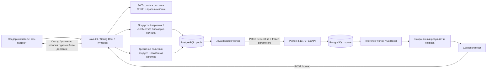
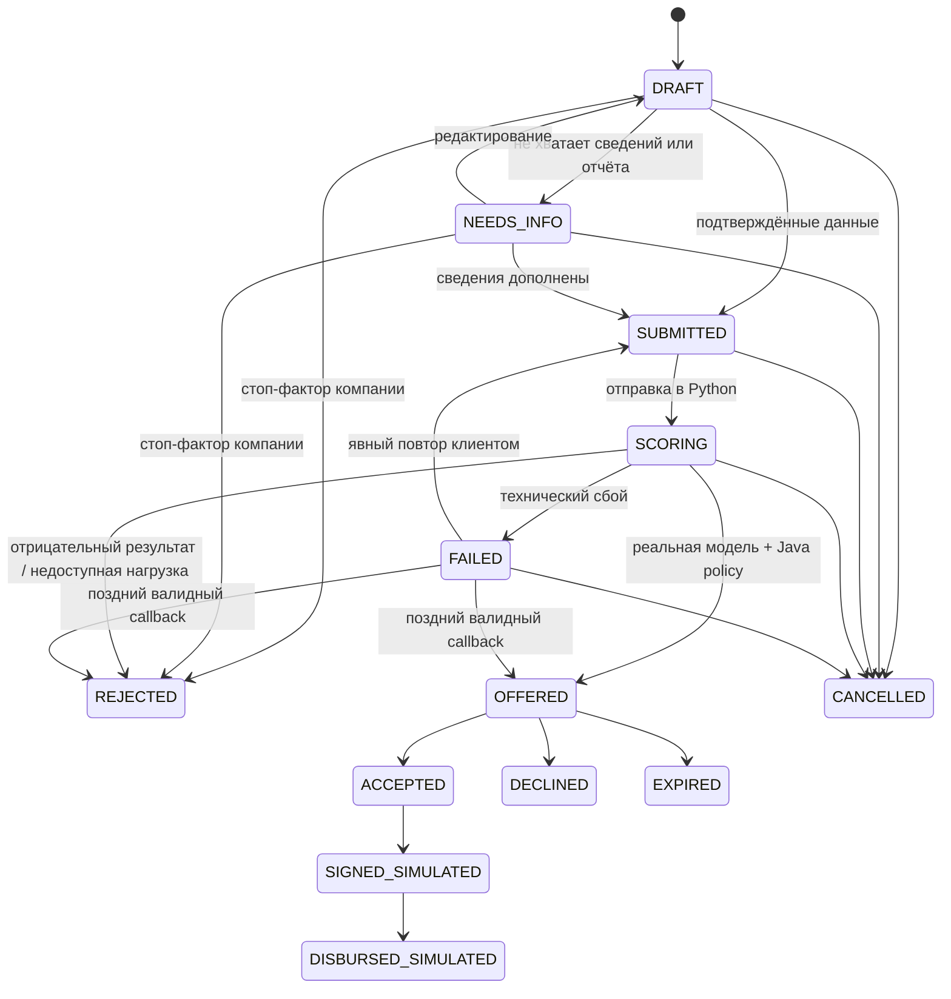
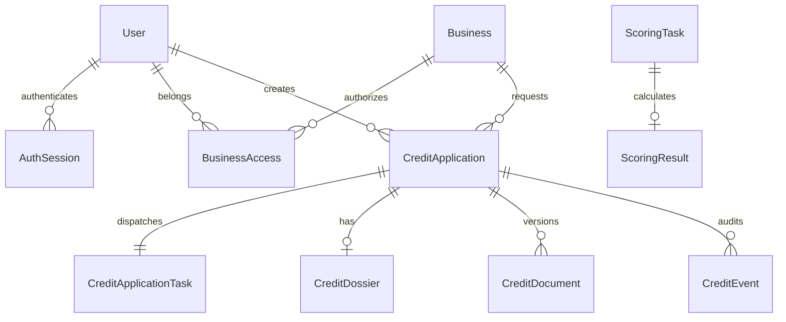

# Реализованная архитектура MVP

Эта схема описывает исполняемую поставку. `architecture.md` остаётся исходным расширенным планом.

В Compose запускаются `postgres`, `scorer` и `app`. Два Python-воркера — фоновые задачи одного
FastAPI-процесса, загружающего модель один раз. Долгие вычисления выполняются вне event loop;
модель ограничена двумя CPU-потоками. Все обязательные ресурсы локальны и бесплатны. В runtime
нет LLM, платных API, обучения при старте и генератора фиктивных скоринговых ответов.

## Состояния

Клиентский `state` хранится в `CreditDossier`; технические состояния Java-заявки/очереди и Python
не подменяют бизнес-результат. Отказ и ошибка обработки различаются. Подписание и выдача явно
обозначены как имитации; реальных юридических/денежных операций нет.

## Модель данных

`ScoringTask.id` / `ScoringResult.application_id` — UUID Java-заявки. Межсервисная связь логическая,
без межсхемного FK: Python не изменяет таблицы Java. Один экземпляр PostgreSQL в MVP содержит
две схемы; их можно вынести в разные БД без изменения HTTP-контрактов.

| Данные | Содержание / инвариант |
| --- | --- |
| User, AuthSession, BusinessAccess | Пароль-хеш, сессия, членство и роль OWNER/ADMIN/VIEWER; проверяются на каждом запросе |
| Business | Заявленные сведения компании; синтетические профили предзаполнены при первом запуске |
| CreditApplication | Параметры заявки, компания, автор, технический статус и исходный callback |
| CreditApplicationTask | Неизменяемый payload после отправки, lease, attempts, dispatched, ошибки; WAITING_INPUT не обрабатывается |
| CreditDossier | Продукт, финансовые показатели, revision, ключ идемпотентности, снимок подачи, решение и условия |
| CreditDocument | Неизменяемые версии JSON-отчёта до 1 МиБ, SHA-256, данные в BYTEA |
| CreditEvent | Упорядоченная история: revision, состояние, причина, время, относящиеся к событию снимки |
| scorer.scoring_queue | Вход, статус, attempts, next_attempt_at/lease, lease_token, безопасный код ошибки |
| scorer.scoring_result | Прогноз, хеш модели, версия интерпретации, зафиксированный callback, доставка/попытки/lease |

Java: Flyway V1–V7. Python: создание собственной схемы и идемпотентное добавление retry-полей под
advisory-lock; Java-миграции и таблицы не затрагиваются. Самостоятельные SQLAlchemy-модели и
политика создания схемы перечислены в `code/scorer/scorer_service/storage.py`.

## Надёжность и безопасность

- Java сохраняет отправку и состояние транзакционно; HTTP выполняется после освобождения lock.
- Python отвечает 202 после commit. Claim блокируется `FOR UPDATE SKIP LOCKED`; вычисление и HTTP
  выполняются вне транзакции. Просроченный lease подбирается; старый владелец не перезаписывает результат.
- Результат фиксируется до отправки. Повторная доставка использует сохранённый callback и не вызывает модель.
- Для сбоев есть таймауты, предел попыток и задержка; постоянные 4xx не блокируют очередь других заявок.
- Java дедуплицирует одинаковые результаты, отклоняет конфликт и поздний результат отменённой заявки.
- `retry` сохраняет вход и UUID; признак dispatched позволяет принять валидный поздний callback между повторами.
- Сервисный токен общий только между Java/Python; браузер его не получает. Клиентские мутации требуют CSRF.
- Проверка документов не использует пути пользователя, произвольный код или OCR. Скачивание проверяет компанию.
- Health проверяет БД, а у Python также загруженную модель и живые воркеры. Ошибки не логируют токены/параметры.

## Границы

Внешние реестры/БКИ/ФНС не вызываются и не выдаются за выполненные проверки: Business содержит
заявленные сведения. ML обучен на синтетических ставках, не на реальных дефолтах. Пороги и правила
продуктов упрощены и описаны в документации. Банковская сторона автоматическая; отдельного рабочего
места кредитного инспектора нет. Для публичного production-размещения нужны собственные ключи,
секреты, HTTPS, политика хранения/доступа, миграции Python с версионированием и мониторинг.
