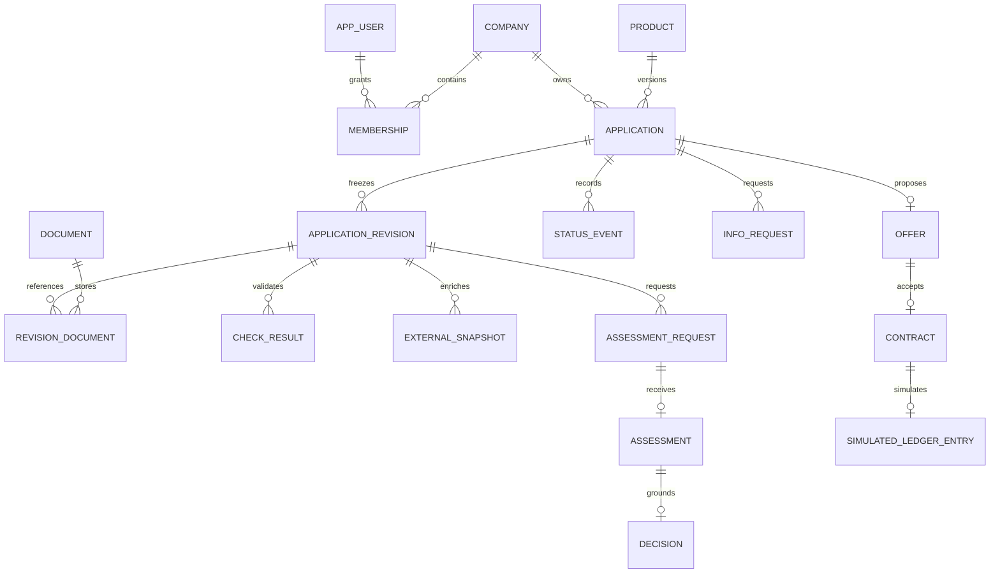
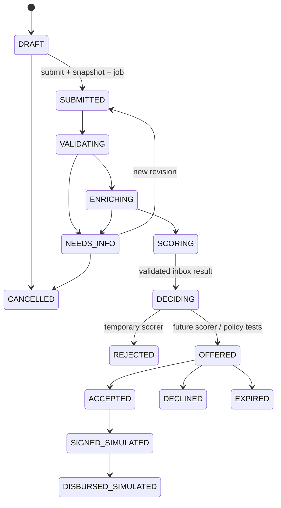

# Модель данных и состояния

Полный DDL — Flyway SQL в `credit/src/main/resources/db/core` и `assessment/src/main/resources/db/assessment`. Hibernate проверяет схему, не создаёт её. JPA управляет application aggregate с @Version, JdbcTemplate — остальными записями и специальными запросами. JpaTransactionManager и TransactionAwareDataSourceProxy связывают очередь с тем же соединением.

`auth`: app_user, membership, spring_session и spring_session_attributes. Пароли BCrypt cost 12, сессии JDBC. `core`: company, product, application и связанные сущности, command (user+command_id), inbox_event (event_id+hash), audit_event, job/job_attempt/scheduled_tasks. `assessment`: request с результатом и callback_state, свой job/job_attempt/scheduled_tasks. Роль assessment не имеет прав на core/auth; callback взаимодействует по HTTP.

Приложение сохраняет черновик JSON и текущую revision. Submit замораживает данные компании/финансы/документы/версию продукта/дату asOf. Снимок и ссылки на документы не меняются при исправлении черновика. Проверки, внешние снимки с fixtureVersion и response hash, assessment и decision привязаны к revision. Денежные значения — long копейки, расчёты — BigDecimal, ставки numeric. Уникальные offer/application, contract/offer и ledger/contract защищают от повторных эффектов.

Техническая обработка отдельно: IDLE/RUNNING/RETRY_WAIT/FAILED у application; PENDING/RUNNING/RETRY_WAIT/SUCCEEDED/FAILED у job. RETRY_WAIT/attempts находятся в job и расписании db-scheduler. Сбой не меняет бизнес-статус на REJECTED. Операции используют блокировку aggregate и проверку version; command advisory lock сериализует одинаковые команды создания. Клиент не передаёт желаемый статус.

Загрузка документа сначала фиксирует PENDING metadata и cleanup job, затем записывает S3 и переводит metadata в READY. Повтор той же команды завершает незавершённую загрузку. После часа PENDING объект удаляется cleanup job и помечается DELETED; READY файлы не удаляются. Это исключает неизвестные S3 ключи при падении процесса между S3 и БД. В БД сохраняются object_key/checksum/metadata, не публичный URL.
